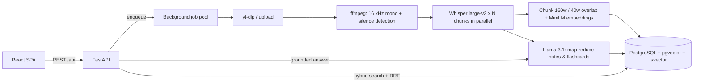

# Noteplify

**Turn any lecture into notes you'll actually use.** Upload a lecture recording or paste a YouTube link — Noteplify transcribes it with Whisper, then generates structured notes, flashcards, and a searchable, citation-backed Q&A over the lecture. Everything links back to the exact second it was said, and any of it can be read aloud.

**Stack:** FastAPI · PostgreSQL + pgvector · Hugging Face Inference (Whisper large-v3, Llama 3.1 8B, MiniLM) · RAG with hybrid retrieval · React + TypeScript + Tailwind · Web Speech API · Docker

---

## Features

| | |
|---|---|
| 🎙️ **Transcription** | Whisper large-v3 via Hugging Face. Audio is normalised to 16 kHz mono, split on **silences** into ≤30 s chunks (no words cut in half), and transcribed **in parallel**. Optional local `faster-whisper` backend. |
| 📝 **Structured notes** | Map-reduce over ~1,500-word sections: each section gets a title, summary, key points and term definitions; a reduce step writes the overview + key takeaways. Export as Markdown. |
| 🃏 **Flashcards** | Generated per section, de-duplicated. Flip, shuffle, "I know it / review again", study-missed mode, keyboard shortcuts. |
| 🔎 **RAG Q&A + search** | Transcript → overlapping 160-word chunks with interpolated timestamps → embeddings in **pgvector**. Retrieval is **hybrid**: cosine similarity + Postgres full-text rank, merged with **Reciprocal Rank Fusion**. Answers cite excerpts; citations are clickable timestamps. Search works across all your lectures. |
| 🔊 **Read aloud** | Web Speech API (`speechSynthesis`) reads notes, sections, answers and flashcards, with adjustable speed. Ask questions by voice (`SpeechRecognition`, Chromium). |
| ⏱️ **Metrics** | Every run records per-stage timing → **processing minutes per hour of audio** and real-time factor. Paste a reference transcript to compute **WER** (substitutions / deletions / insertions). Dashboard + offline benchmark script. |
| 🔐 **Accounts** | Email/password auth (bcrypt + JWT); every lecture is private to its owner. Audio streams via short-lived, lecture-scoped media tokens. |

## Architecture



**Pipeline stages** (each timed and stored in `processing_metrics`):
`download → preprocess → transcribe → index → generate`. Jobs run in a bounded thread pool, report progress to the DB (the UI polls), and **resume automatically after a restart**.

## Metrics methodology

- **WER** = (S + D + I) / N reference words, computed with `jiwer` after normalising both texts (lower-case, punctuation stripped, whitespace collapsed). The benchmark script reports **corpus WER** (word-weighted across files).
- **Processing time per hour of audio** = wall-clock pipeline seconds ÷ audio seconds × 60. Real-time factor (RTF) is the same ratio unscaled; `1/RTF` = "×faster than real time".
- Silence-aligned chunking is designed to avoid splitting words at chunk edges — a common WER source in chunked long-form ASR. To quantify it, run the benchmark with `CHUNK_SEARCH_WINDOW=0` (fixed 30 s cuts) and with the default, and compare. `ASR_CONCURRENCY` trades provider rate limits for lower minutes per audio hour.

Run the offline benchmark (no database needed) on pairs of `audio` + same-name `.txt` reference:

```bash
cd backend
python -m scripts.benchmark benchmarks/samples --out benchmarks/results.json
```

Good reference sets: LibriSpeech test-clean, TED-LIUM 3, or lectures with human-made captions. Measured so far:

| Dataset | Model / hardware | Audio | WER | Min / audio hour |
|---|---|---:|---:|---:|
| `benchmarks/samples/tts_gradient_descent` (synthetic TTS speech, 235 words) | faster-whisper small, int8, laptop CPU | 1.5 min | 4.26% | 17.5* |
| _LibriSpeech / TED-LIUM — your run_ | | | | |

\* Includes one-time model load; on a single 93 s clip that dominates. Synthetic TTS speech is cleaner than a real classroom, so treat its WER as a sanity check, not a headline number.

## Run it locally

### Option A — Docker (easiest)

Needs Docker Desktop. Create a `.env` next to `docker-compose.yml`:

```
HF_TOKEN=hf_your_token_here
# or, to explore the UI without any AI calls:
# MOCK_AI=true
```

```bash
docker compose up --build
```

Open http://localhost:8000.

### Option B — Manual (for development)

Requirements: **Python 3.11+**, **Node 20+**, **ffmpeg** on PATH, and PostgreSQL with pgvector (simplest: `docker run -p 5432:5432 -e POSTGRES_USER=noteplify -e POSTGRES_PASSWORD=noteplify -e POSTGRES_DB=noteplify pgvector/pgvector:pg16`, or a free Neon database).

```bash
cd backend
python -m venv .venv
.venv\Scripts\activate          # macOS/Linux: source .venv/bin/activate
pip install -r requirements-dev.txt
copy .env.example .env          # macOS/Linux: cp .env.example .env  — then fill in HF_TOKEN
uvicorn app.main:app --reload
```

```bash
cd frontend
npm install
npm run dev
```

Open http://localhost:5173 (Vite proxies `/api` to the backend on :8000). API docs: http://localhost:8000/docs.

Run backend tests: `cd backend && pytest`.

### Local AI mode (free, offline)

Hugging Face Inference Providers need account credits (a free account with none left gets `402 Payment Required`). Noteplify can run every AI step on your own machine instead:

| Step | Local engine | Setting |
|---|---|---|
| Speech-to-text | faster-whisper (CTranslate2, int8 on CPU) | `TRANSCRIBE_BACKEND=local`, `LOCAL_WHISPER_SIZE=small` |
| Embeddings | fastembed (ONNX) — same MiniLM model, 384-d | `EMBEDDING_BACKEND=local` |
| Notes / Q&A | [Ollama](https://ollama.com) with Llama 3.2 3B, JSON-constrained output | `LLM_BACKEND=ollama`, `OLLAMA_MODEL=llama3.2:3b` |

```bash
cd backend
pip install -r requirements-local.txt
ollama pull llama3.2:3b
```

Then set the variables above in `backend/.env` (see `.env.example`). Use `LLM_CONCURRENCY=1` and `MAX_CONCURRENT_JOBS=1` on a CPU-only machine. The backends can be mixed (e.g. local Whisper + HF LLM).

> **Windows 11 note:** Smart App Control blocks recent `ctranslate2` DLLs (`WinError 4551`) until they gain reputation; `requirements-local.txt` pins `ctranslate2==4.5.0`, which loads fine.

### Getting a Hugging Face token

1. Create a free account at huggingface.co → Settings → Access Tokens → **New token** (fine-grained) with **"Make calls to Inference Providers"**.
2. For `meta-llama/*` models, accept the model licence on its model page (or set `LLM_MODEL` to e.g. `Qwen/Qwen2.5-7B-Instruct`).

## Deploy

### Render (one blueprint, free tier)

1. Push this repo to GitHub.
2. Render → **New → Blueprint** → select the repo. `render.yaml` creates the Docker web service and a Postgres database (pgvector is enabled automatically on first start).
3. Set `HF_TOKEN` in the web service's **Environment** tab → redeploy.

Notes: Render's free disk is ephemeral, so uploaded audio disappears on restart (notes, transcripts and flashcards live in Postgres and are kept). Free services sleep when idle.

### Any Docker host (Railway, Fly.io, Hugging Face Spaces, a VPS)

Build the root `Dockerfile`, give it a `DATABASE_URL` (Neon/Supabase both support pgvector), `JWT_SECRET`, and `HF_TOKEN`. The container listens on `$PORT` (default 8000; set `PORT=7860` for HF Spaces).

### Split frontend (Vercel) + API

Deploy `frontend/` to Vercel with `VITE_API_URL=https://<your-api-host>`, and set `CORS_ORIGINS=https://<your-vercel-domain>` on the API.

### YouTube on cloud servers

YouTube often blocks datacenter IPs ("Sign in to confirm you're not a bot"). If that happens, export cookies from a logged-in browser in Netscape format and point `YTDLP_COOKIES_FILE` at it (as a secret file), or upload the recording directly.

## Configuration

All settings are environment variables — see [`backend/.env.example`](backend/.env.example).

| Variable | Default | Purpose |
|---|---|---|
| `DATABASE_URL` | local Postgres | `postgres://` URLs are accepted and normalised |
| `HF_TOKEN` | — | Hugging Face token (required unless `MOCK_AI=true`) |
| `ASR_MODEL` | `openai/whisper-large-v3` | Speech-to-text model |
| `LLM_MODEL` | `meta-llama/Llama-3.1-8B-Instruct` | Notes, flashcards, answers |
| `EMBEDDING_MODEL` / `EMBEDDING_DIM` | `all-MiniLM-L6-v2` / `384` | Must match each other |
| `TRANSCRIBE_BACKEND` | `hf` | `local` uses faster-whisper (`requirements-local.txt`) |
| `EMBEDDING_BACKEND` | `hf` | `local` uses fastembed (ONNX) |
| `LLM_BACKEND` / `OLLAMA_MODEL` | `hf` / `llama3.2:3b` | `ollama` runs the LLM locally |
| `ASR_CONCURRENCY` | `4` | Parallel Whisper requests per lecture |
| `MOCK_AI` | `false` | Simulated AI for UI development and demos |
| `MAX_UPLOAD_MB` / `MAX_AUDIO_MINUTES` | `500` / `180` | Limits |

## API

Interactive docs at `/docs`. Main endpoints (all under `/api`, bearer-token auth):

| Method | Path | |
|---|---|---|
| POST | `/auth/register`, `/auth/login` | Get a JWT |
| POST | `/lectures/upload` · `/lectures/youtube` | Create a lecture and start processing |
| GET | `/lectures` · `/lectures/{id}` | List / detail (status, progress, notes, metrics) |
| GET | `/lectures/{id}/transcript` · `/flashcards` · `/export` | Content |
| POST | `/lectures/{id}/ask` | RAG answer with cited sources |
| GET | `/search?q=` | Hybrid search across your lectures |
| POST | `/lectures/{id}/wer` | Score against a reference transcript |
| GET | `/metrics/summary` | Aggregate speed / accuracy metrics |

## Project structure

```
backend/
  app/
    main.py            FastAPI app, CORS, serves built SPA
    pipeline.py        job runner + the 5-stage pipeline
    models.py          SQLAlchemy models (pgvector column on chunks)
    routers/           auth, lectures, qa (ask/search), metrics
    services/          audio (ffmpeg), youtube, transcribe, embeddings,
                       llm, notes (map-reduce), rag (hybrid + RRF), wer
  scripts/benchmark.py offline WER + speed benchmark
  tests/               unit tests for chunking, RRF, WER, parsing…
frontend/
  src/pages/           Landing, Auth, Dashboard, LectureDetail, Metrics
  src/components/      Player, NotesView, FlashcardsView, TranscriptView, AskView, charts…
  src/context/         Auth + shared read-aloud (Web Speech API)
Dockerfile · docker-compose.yml · render.yaml
```

## Resume bullets (fill in your measured numbers)

- Built **Noteplify**, a full-stack lecture-to-notes platform (FastAPI, PostgreSQL/pgvector, React/TypeScript) that turns recordings and YouTube links into timestamped transcripts, structured notes, flashcards and cited Q&A.
- Engineered a parallel Whisper large-v3 transcription pipeline with **silence-aware chunking**, processing 1 h of audio in **X min** (RTF **0.0X**) at **X% WER** on LibriSpeech/TED-LIUM.
- Implemented **hybrid RAG retrieval** (pgvector cosine + Postgres full-text, fused with Reciprocal Rank Fusion) with timestamp-linked citations; map-reduce LLM summarisation for long lectures.
- Instrumented per-stage latency and WER tracking with a metrics dashboard and an offline benchmark harness; shipped as a single Docker image with one-click Render deployment.

## Limitations & next steps

- Jobs run in-process (one uvicorn worker). For scale, move `pipeline.enqueue` to a queue (Redis + RQ/Celery) and store audio in S3/R2.
- Tables are created with `create_all`; add Alembic migrations before evolving the schema in production.
- Timestamps come from chunk boundaries (≤30 s) and are interpolated per word; word-level timestamps would sharpen citations.
- Speaker diarisation and slide/OCR ingestion are natural extensions.
